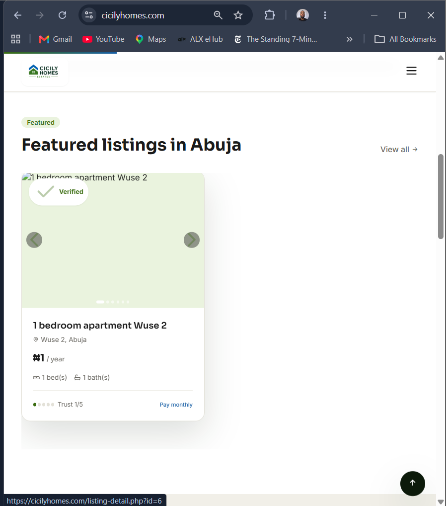

# Insecure File Storage Leading to Data Loss After Deployment

**Date:** 2nd November 2026  
**Reporter:** Chukwuemeka Nze  
**Platform:** CicilyHomes Estates (cicilyhomes.com)  
**Category:** Security Misconfiguration / Insecure Data Storage  
**Severity:** Medium  
**Status:** Open  

---

## 1. Summary

Property images uploaded by landlords become inaccessible (broken/missing) after a new version of the website is deployed. This forces the team to request users to re-upload their images, which is not acceptable when handling real user data.

---

## 2. Evidence

### Screenshot 1 – Broken Image on Featured Listings Page

> The property card shows all text details and the “Verified” badge, but the image area is blank.

### Screenshot 2 – Broken Image on Listing Card

> Same issue confirmed on the individual listing view (`listing-detail.php?id=6`).

---

## 3. Root Cause

Property images are stored inside the application directory (likely `/public/uploads` or similar).  
During deployment, this folder is overwritten or cleared, which breaks all existing image URLs.

---

## 4. Impact

- **Data Availability:** User-uploaded images are lost after routine maintenance
- **User Trust:** Landlords are asked to re-upload data
- **Professionalism:** Verified listings appear incomplete
- **Scalability Risk:** The issue will worsen as more users upload properties

---

## 5. Recommended Remediation

### Immediate & Permanent Fix:

1. Move all property images to a **persistent storage** solution:
   - Preferred: Cloudinary, AWS S3, or DigitalOcean Spaces
   - Alternative: A directory outside the project folder

2. Store only the full image URL in the database

3. Update the upload and display logic to use absolute URLs

4. Create a one-time migration script to move existing images (do not ask users to re-upload)

5. Ensure future deployments never touch the image storage location

---

## 6. Lessons Learned

User-generated content (especially images and documents) must never be stored inside the application codebase. Persistent storage should be treated as a security and reliability requirement from the beginning.

---

## 7. Status

- [ ] Fix implemented
- [ ] Existing images migrated
- [ ] Post-deployment verification added
